# Portfolio - Maxime JOLIVET // Nuxt 4 SSR

**Lancer le site en local : `npm install` → copier `.env.example` en `.env` → `npm run dev` → http://localhost:8000**

Portfolio personnel de Maxime Jolivet, développeur web full-stack. Multilingue (FR/EN/BR), SSR sur Vercel.

[](LICENSE.md)

[](https://www.maxime.bzh)
[](https://github.com/maximejolivet/portfolio/actions/workflows/ci.yml)
[](https://sonarcloud.io/summary/new_code?id=maximejolivet_portfolio)


## Démarrage rapide

1. `npm install`
2. Copier `.env.example` en `.env`, renseigner `supabaseUrl` et `supabaseKey`
3. `npm run dev` → http://localhost:8000 (port non standard, voir `nuxt.config.ts`)

Autres gestionnaires : `pnpm install` / `yarn install` / `bun install`, puis `pnpm run dev` / `yarn dev` / `bun run dev`.

## Déployer

1. Travailler sur `develop`
2. Ouvrir une PR `develop` → `master`
3. Merge → Vercel déploie automatiquement (intégration Git, build SSR standard, pas d'export statique)

## Commandes

**Dev & build**

```bash
npm run dev        # serveur de dev, :8000
npm run build      # build SSR (production)
npm run preview    # prévisualiser le build
npm run generate   # export statique — manuel/local uniquement, pas le chemin de prod
```

Équivalents pnpm/yarn/bun : remplacer `npm run` par `pnpm run`, `yarn` ou `bun run`. Voir la [doc de déploiement Nuxt](https://nuxt.com/docs/getting-started/deployment).

**Qualité**

```bash
npm run lint           # ESLint only
npm run lintfix        # ESLint --fix (+ auto-format via Prettier)
npm run prettier       # Check format (fail on mismatch) — même chose que npx prettier --check .
npm run prettier:fix   # Format files in-place
npm run test           # Vitest
```

Conventions : pas de point-virgule, guillemets simples, indentation 2 espaces, largeur 100 (détail dans `CLAUDE.md`).

**Makefile**

```bash
make infos         # Infos projet (version, Node, branche...) et liste des commandes
make install       # npm install
make dev           # Serveur de dev
make build         # Build SSR
make generate      # Build statique (manuel/local, pas le chemin de prod)
make preview       # Prévisualiser un build généré
make deploy        # Build + generate
make lint          # ESLint only
make lintfix       # ESLint --fix
make prettier      # Check format
make prettier-fix  # Format in-place
make test          # Vitest
make icons         # Régénère utils/generated/icon-subset.json
make clean         # Supprime .nuxt, .output, node_modules
```

## Mettre à jour les dépendances

1. `npm install -g npm-check-updates` (une fois)
2. `ncu` — liste les paquets à mettre à jour
3. `ncu -u` — met à jour `package.json`
4. `npm install`

## Stack technique

**Cœur**

- **Framework** : [Nuxt 4](https://nuxt.com) (SSR en dev comme en prod, hébergé sur Vercel) — [doc](https://nuxt.com/docs/getting-started/introduction)
- **UI** : Vue 3, composants par domaine (`components/sections`, `cards`, `layout`, `ui`, `navigation`)
- **State** : Pinia
- **Data** : Supabase (articles de blog, études de cas projets)

**Transverse**

- **i18n** : `@nuxtjs/i18n`, trois locales (`fr` par défaut, `en-US`, `br-FR`), préfixe d'URL (`/fr/...`, `/en/...`, `/br/...`)
- **Sécurité** : `nuxt-security` (CSP stricte avec nonce)
- **SEO** : `@nuxtjs/sitemap`, `@nuxt/image`
- **Icônes** : `@iconify-json/*` (devicon, devicon-plain, logos, lucide, material-icon-theme, selfhst, skill-icons), via `utils/resolveIcon.ts` et un sous-ensemble généré (voir [Icônes](#icônes))

## Pages

| Route (FR)          | Route (EN)        | Route (BR)          | Contenu                                      |
| ------------------- | ----------------- | ------------------- | -------------------------------------------- |
| `/`                 | `/`               | `/`                 | Accueil (hero, à propos, expérience, stack)  |
| `/cv`               | `/cv`             | `/cv`               | Curriculum vitæ                              |
| `/projets`          | `/projects`       | `/raktresou`        | Liste des projets (noindex - travail client) |
| `/projets/:slug`    | `/projects/:slug` | `/raktresou/:slug`  | Étude de cas projet (noindex si `pro`)       |
| `/blog`             | `/blog`           | `/blog`             | Liste des articles                           |
| `/blog/:slug`       | `/blog/:slug`     | `/blog/:slug`       | Article de blog                              |
| `/mentions-legales` | `/legal-notice`   | `/menegou-lezennel` | Mentions légales                             |
| `/accessibilite`    | `/accessibility`  | `/haezadusted`      | Déclaration d'accessibilité                  |
| `/nouveautes`       | `/changelog`      | `/kemmou-nevez`     | Journal des mises à jour (généré depuis Git) |
| `/status`           | `/status`         | `/status`           | État du build/déploiement                    |

## Architecture

```mermaid
flowchart TD
  visitor((Visitor))

  subgraph presentation["Portfolio presentation"]
    app["Nuxt application<br/>app.vue"]
    home["Home page<br/>index.vue"]
    sections["Portfolio sections"]
    locale["Locale rendering<br/>i18n.config.ts"]
  end

  subgraph engagement["Visitor engagement"]
    chat["AI chat widget"]
    contact["Contact section<br/>ContactSection.vue"]
    cal["Cal.eu booking"]
  end

  subgraph content["Content and projects"]
    projects["Projects listing<br/>index.vue"]
    study["Project case study<br/>[slug].vue"]
    blog["Blog listing<br/>index.vue"]
    article["Blog article<br/>[slug].vue"]
    clients["Client sectors<br/>ClientsSection.vue"]
    cards["Project cards<br/>ProjectCard.vue"]
    projectQ["Project queries<br/>useProjects.ts"]
    articleQ["Article queries<br/>useArticle.ts"]
    listQ["Article list queries<br/>useArticles.ts"]
  end

  subgraph ssr["SSR and APIs"]
    api["Machine-readable APIs"]
    llm["LLM content endpoint"]
    db[("Supabase content")]
  end

  visitor -->|requests route| app
  app -->|renders route| home
  app -->|loads locale| locale
  app -.->|loads widget| chat
  home -->|renders sections| sections
  home -->|translates content| locale

  contact -.->|books call| cal

  app -->|renders route| projects
  app -->|renders route| study
  app -->|renders route| blog
  app -->|renders route| article

  projects -->|renders sectors| clients
  projects -->|renders results| cards
  projects -->|loads projects| projectQ
  projectQ -->|returns projects| projects
  study -->|loads case study| projectQ
  blog -->|loads articles| listQ
  listQ -->|returns articles| blog
  article -->|loads article| articleQ
  articleQ -->|returns article| article

  content -->|translates filters, studies, articles| locale

  projectQ -->|reads projects| db
  articleQ -->|reads article| db
  listQ -->|reads articles| db
  api -->|serves content| db
  llm -->|reads projects| db

  classDef presentationNode fill:#dbeafe,stroke:#2563eb,color:#1e3a8a
  classDef engagementNode fill:#ffe4e6,stroke:#be123c,color:#881337
  classDef contentNode fill:#fef3c7,stroke:#d97706,color:#78350f
  classDef ssrNode fill:#dcfce7,stroke:#16a34a,color:#14532d
  class app,home,sections,locale presentationNode
  class chat,contact,cal engagementNode
  class projects,study,blog,article,clients,cards,projectQ,articleQ,listQ contentNode
  class api,llm,db ssrNode
```



## Icônes

**Icône manquante ? Lancer `npm run icons:generate` (ou `make icons`) et lire le warning : il indique le préfixe/nom fautif.**

- `scripts/generate-icon-subset.mjs` scanne le code (`icon="prefix:nom"`) et génère `utils/generated/icon-subset.json` avec les seules icônes utilisées.
- Tourne tout seul avant `dev`, `build`, `generate`, `deploy` et après `install` (hooks `pre*`/`postinstall`).
- `utils/generated/` est gitignoré, régénéré à chaque fois.
- Pourquoi : les `icons.json` complets des paquets `@iconify-json/*` pèsent jusqu'à ~31 Mo cumulés et faisaient planter `nuxt build`/`nuxt generate` (mémoire). `utils/resolveIcon.ts` ne les lit donc jamais directement.

## CI & sécurité

`.github/workflows/ci.yml` tourne sur push/PR vers `master` (pas sur simple push `develop`) :

- **lint-test** : `npm run lint`, `npm run test`, et `sfw npm ci` ([Socket Firewall](https://socket.dev)) qui bloque les paquets malveillants/typosquattés à l'installation
- **SonarQube Cloud** : scan + quality gate bloquant
- **[Socket Security GitHub App](https://github.com/marketplace/socket-security)** (installée hors dépôt) : commente/vérifie chaque PR sur le risque des dépendances ajoutées

## Claude Code Skills

`.claude/skills/` :


## Releases (dev)

**Ne pas éditer à la main.** Chaque commit bump la version patch du `package.json` et ajoute un tag ci-dessous (hook `pre-commit`, `scripts/update-release-log.mjs`).

<!-- releases:start -->


<!-- releases:end -->
